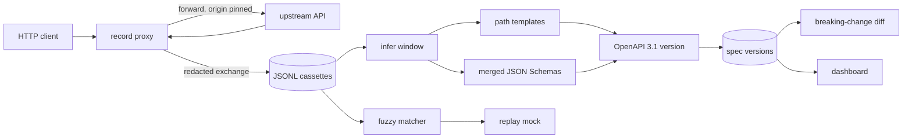

# api-time-machine

Record live HTTP traffic in front of any JSON API, infer a versioned **OpenAPI 3.1** contract, report **breaking changes** between versions, and serve a **deterministic replay mock** from the cassette.

The recording proxy is pinned to one upstream origin. Secrets and common PII are redacted before anything is written. Specs are inferred from a traffic *window*, not from the union of every historical shape, so a deploy that changes `price` from a number to a string shows up as a break instead of a quiet `string | number` union.



## Quickstart

Requires Node.js 22+.

```bash
npm install
npm run build

# terminal 1 — sample API, generation 1
node examples/upstream.mjs --port 4000 --version 1

# terminal 2 — recording proxy
node dist/cli.js record --upstream http://127.0.0.1:4000 --port 8787 --store .atm

# terminal 3 — drive a little traffic, including a secret that must not be stored
curl -s -H 'Authorization: Bearer super-secret' http://127.0.0.1:8787/books
curl -s http://127.0.0.1:8787/books/1
curl -s http://127.0.0.1:8787/authors/10
curl -s -X POST http://127.0.0.1:8787/books \
  -H 'content-type: application/json' \
  -d '{"title":"Parable","author":"Butler","price":20,"password":"hunter2"}'

node dist/cli.js infer --store .atm --title Bookstore
node dist/cli.js versions --store .atm
```

Switch the upstream to `--version 2`, record another pass (list books with `?cursor=page-2`, post with `isbn`, call `/books/1/related`), then:

```bash
node dist/cli.js infer --store .atm
node dist/cli.js diff --store .atm          # exit 1 when the contract breaks
node dist/cli.js replay --store .atm --port 8788
node dist/cli.js dashboard --store .atm --port 8789
```

`GET http://127.0.0.1:8788/books/999` returns a recorded book even though `999` was never seen: the path matches `/books/{bookId}`. The dashboard at `http://127.0.0.1:8789` lists endpoints, a per-operation schema timeline, and the breaking-change report.

`npm run demo` runs that whole loop against the sample upstream and checks redaction, the diff, and replay.

## CLI

| Command | What it does |
| --- | --- |
| `atm record --upstream URL` | Reverse proxy. Writes one JSONL session under the store. |
| `atm infer` | Infer OpenAPI from the next unseen traffic window and store a version. |
| `atm diff` | Diff the last two versions. Exit `1` when breaking changes exist. |
| `atm replay` | Mock server. `--mode fuzzy` (default), `strict`, or `path`. |
| `atm dashboard` | Local UI over the store. |
| `atm versions` | Watermark, exchange count, and version list. |

Shared flags: `--store` (default `.atm`), `--port`, `--host` (default `127.0.0.1`). `infer` accepts `--all`, `--session`, `--title`, `--force`, `--json`. `diff` accepts `--from`, `--to`, `--json`, and `--fail-on breaking|warning|none`. `replay` accepts `--prefer newest|oldest` (default `newest`) and `--session`.

## Recording and redaction

The proxy buffers the request, forwards it to the configured upstream, and returns the upstream bytes unchanged. Redaction happens only on the cassette. A dropped `Authorization` header would break the call; storing it would leak it.

Built-in rules cover:

- Headers such as `authorization`, `cookie`, `set-cookie`, and common API-key headers
- JSON keys split on camelCase and separators (`password`, `accessToken`, `clientSecret`, `creditCard`, …)
- Query keys such as `token` and `api_key`
- String values matching emails, SSNs (`ddd-dd-dddd`), JWTs, and credit-card numbers that pass the Luhn check

Pass `--redact examples/redaction.json` to add headers, keys, or value patterns. Set `"builtins": false` to start from an empty ruleset. Binary bodies are stored as base64 and are not redacted. The default body cap is 5 MiB (`413` above that).

The upstream origin is fixed. An absolute or protocol-relative request-target cannot retarget the host; only its path and query are joined onto the configured base.

## Inference

`atm infer` reads exchanges with `seq` greater than the store watermark and builds one OpenAPI 3.1 document from that window.

**Paths.** Segments that look like ids (integers other than years 1900–2100, UUIDs, ULIDs, ObjectIds, long hex or mixed tokens) become parameters, including from a single sample. `/users/42` and `/users/7` collapse to `/users/{userId}`. Names come from the previous static segment (`reviews` → `reviewId`). Known aliases stay literal, so `/users/me` is not swallowed by `/users/{userId}` when both appear. Low-cardinality words stay literal (`/pets/dogs`, `/pets/cats`). High-cardinality literals under a plural collection (`/orgs/acme`, `/orgs/globex`, …) become parameters.

**Schemas.** Each JSON sample updates an accumulator. Object properties are the union of observed keys. A property is **required** only when it is present on every object sample in the window; otherwise it is optional. Conflicting types become an OpenAPI 3.1 type array (`["integer", "null", "string"]`). Integer and number collapse to `number`. Strings pick up `format` when every sample agrees (`date-time`, `date`, `uuid`, `email`, `uri`). A small repeated set of lowercase tokens becomes an `enum`. Query and path parameters are coerced (`"10"` → integer, `"true"` → boolean) before the same merger runs. Schemas are inlined, not extracted into `components`, so a diff compares structure rather than generated names.

Observed numeric min/max is intentionally omitted. It tracks the sample window (the largest id seen), not the contract, and would mint a new version whenever an id grew.

## Versioning

Each infer call is a snapshot of one window. The first call consumes every exchange. Later calls consume only exchanges recorded after `inferredThroughSeq`. If the structural hash matches the previous version, the watermark still advances and no duplicate version is written. `--force` writes one anyway. `--all` and `--session` re-infer a chosen slice without moving the watermark.

That window is the product decision that makes diffs meaningful. Merging January's integer `price` with March's string `price` into one schema would hide the break.

```text
.atm/
  meta.json                 # nextSeq, inferredThroughSeq
  recordings/ses_*.jsonl    # header line, then one exchange per line
  specs/index.json
  specs/v-<stamp>-<hash>.json
```

The contract hash is SHA-256 of the paths object with descriptions, examples, summaries, and `x-atm-*` extensions removed.

## Breaking changes

`atm diff` classifies changes for an **existing client**.

| Change | Level |
| --- | --- |
| Endpoint removed | breaking |
| Endpoint added | info |
| `2xx`/`3xx` status removed | breaking |
| Other status removed | warning |
| Status added | info |
| Response field removed, and it was required | breaking |
| Response field removed, and it was optional | warning |
| Response field added | info |
| Response type replaced (`integer` → `string`) or widened (new type, new enum value, became nullable) | breaking |
| Response numeric strictness only (`integer` ↔ `number`) | warning |
| New required request field, query parameter, or request body | breaking |
| New optional request field or query | info |
| Request type narrowed, request enum value removed | breaking |
| Request field removed | info |
| Format changed | warning |

Path-parameter renames show up as an endpoint removed plus an endpoint added, because the template string is the identity of the route. `--fail-on warning` also fails on warnings; `--fail-on none` always exits `0` so a report can be archived from CI without failing the job. The default is to exit `1` when anything breaking is present.

## Replay

The mock loads the cassette once and answers from it.

- **strict** — method, exact path, query pairs, and canonical JSON body must all match.
- **fuzzy** (default) — method plus the learned path template is required. Exact paths, query Jaccard overlap, and a structural body score break ties between candidates.
- **path** — method plus template only.

Equal scores resolve by `--prefer` (default `newest`, then id). The same request always selects the same exchange. A hit sets `x-atm-replay: hit` and `x-atm-exchange-id`. A miss is `404` with `x-atm-replay: miss`. Responses are whatever was stored, which means they are redacted.

## Dashboard

`atm dashboard` serves a single page that reads the store on each request:

- endpoint table for a selected version (method, path, samples, statuses, request and response fields)
- schema timeline for one operation across versions, with the diff against the previous version
- breaking-change report between any two versions

No frontend build step. Assets live in `src/dashboard/public` and are copied next to the compiled server.

## Programmatic use

```js
import { inferOpenApi, diffOpenApi, openStore, inferFromStore } from "api-time-machine";

const spec = inferOpenApi(exchanges, { title: "Catalog" });
const report = diffOpenApi(before, after);
const store = await openStore(".atm");
const version = await inferFromStore(store);
```

Also exported: `startRecordingProxy`, `startReplayServer`, `startDashboard`, `redactExchange`, `learnPaths`, `matchRequest`.

## Development

```bash
npm install
npm test
npm run typecheck
npm run build
npm run demo
```

Tests cover redaction, path templates, schema merging, OpenAPI inference, breaking-change classification, fuzzy and strict replay, the recording proxy (live body is intact, cassette is not), version windows, the dashboard HTTP API, and the CLI. GitHub Actions runs typecheck, tests, the production build, and the walkthrough on Node 22.

## Limitations

- HTTP/1.1 only. No WebSockets, HTTP/2, or gRPC.
- Bodies are buffered, not streamed. Default limit 5 MiB.
- Header maps are flattened; multiple `set-cookie` values are preserved on the live proxy response and joined in the cassette.
- Path inference is a heuristic. A 4-digit year is not treated as an id, but a user id of `2024` will stay literal unless other signals fire. Low-cardinality usernames stay as separate routes until there are at least four distinct values.
- Enum inference needs repeated samples and will not appear for free-form strings. Crossing that threshold between windows is itself a contract change.
- Redaction is best-effort. Review cassettes before committing them. Binary payloads are not scrubbed.
- Replay serves stored, redacted bodies. It does not call the upstream and does not invent responses for routes that were never observed, except by path-template match.
- One writer should append to a store at a time.

## License

MIT. See [LICENSE](LICENSE).
